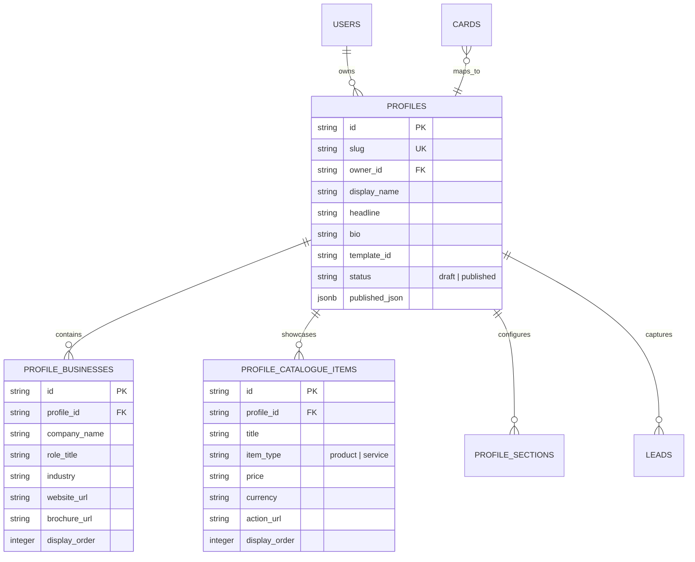

# Tappzio Digital Profile Engine Architecture Skill

Domain engineering specification and implementation standard for Tappzio's core digital profile system, multi-business association architecture, and atomic snapshot compilation.

---

## 1. When to Use This Skill

- Modifying or extending digital profiles in `src/modules/profiles/index.ts`.
- Implementing multi-business entities (`profile_businesses` table).
- Managing product & service catalogue shelves (`profile_catalogue_items` table).
- Implementing reorderable profile sections (`profile_sections` table).
- Compiling pre-rendered JSON snapshots (`published_json`) on publish.

---

## 2. Core Domain Entities & Relationships



---

## 3. Personal vs Single Business vs Multi-Business Architecture

Tappzio supports three distinct profile operational modes:

1. **Personal Executive Profile (`profile_type: 'personal'`)**:
   - Focuses on individual identity, executive bio, social/networking links, and direct vCard download.
2. **Single Business Profile (`profile_type: 'business'`)**:
   - Focuses on a single company entity, company overview, business address, and primary contact channels.
3. **Multi-Business Executive Profile**:
   - Allows 1 person with 1 card to attach up to 10 distinct companies (governed by plan entitlements).
   - Visitors can toggle between businesses via interactive switcher tabs on the public profile.
   - Each business entity carries its own logo, role title, brochure PDF download link, and dedicated catalogue items.

---

## 4. Atomic Snapshot Compilation on Publish

To satisfy the **Zero Dynamic Profile Hot Path** architectural constraint, public profile pages must never execute heavy relational joins across multiple tables on every tap.

When a user clicks "Publish Profile" in the builder:
1. `publishProfile(actor, profileId)` queries the profile, businesses, catalogue items, and active sections.
2. Compiles an atomic JSON snapshot representing the exact rendered state:
   ```json
   {
     "displayName": "Aditya Singhania",
     "headline": "Managing Partner, Singhania Capital",
     "templateId": "obsidian-luxury",
     "businesses": [ ... ],
     "catalogue": [ ... ],
     "sections": [ ... ],
     "publishedAt": "2026-11-02T14:00:00Z"
   }
   ```
3. Updates `profiles.published_json` and sets `status = 'published'`.
4. Syncs the snapshot into Redis cache (`profile:snapshot:${slug}`) for instant edge retrieval.
5. Invalidation: Any profile update purges the Redis cache key and invokes `revalidatePath('/p/' + slug)`.

---

## 5. Mandatory Engineering Rules

1. **Slug Immutability & Collision Safety**: Profile slugs must be normalized (`normalizeSlug`) to lowercase alphanumeric hyphens (`/^[a-z0-9-]+$/`). Slugs must be unique platform-wide.
2. **Entitlement Gate on Profile Creation**: Always call `assertWithinLimit(actor, 'max_profiles', currentCount + 1)` before inserting a new profile.
3. **Multi-Business Limit Enforcement**: Check `assertWithinLimit(actor, 'max_businesses', currentBusinessCount + 1)` before adding a business.
4. **Zero Raw DB Queries in Page Components**: Public page `/p/[slug]` must call `getProfileBySlug(slug)` domain service, never direct `db` queries.

