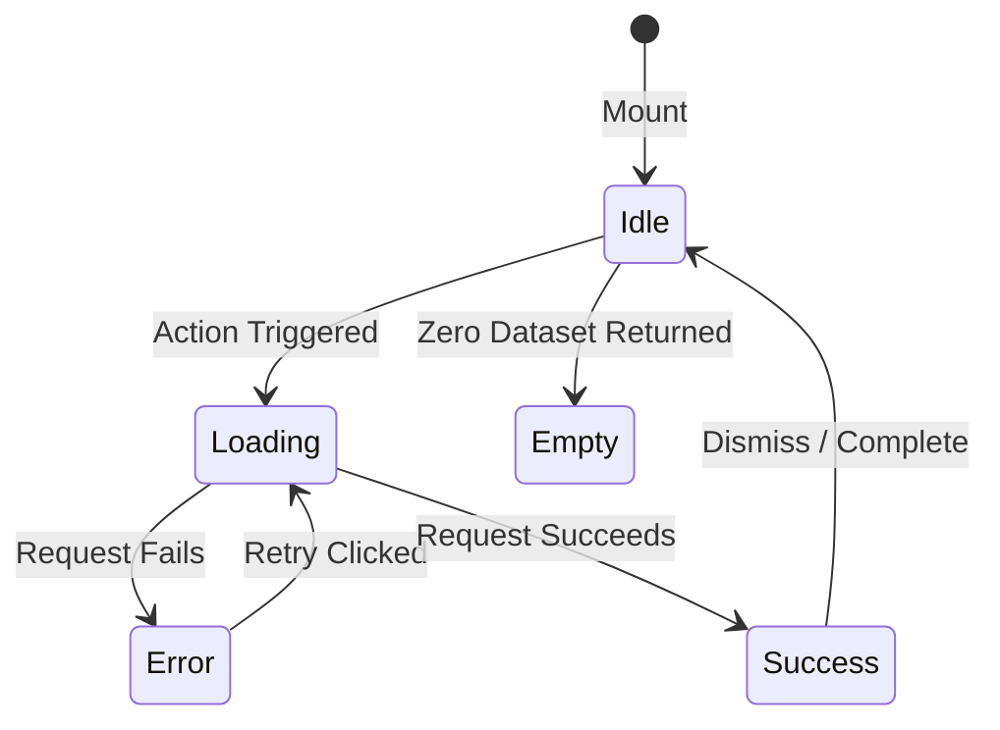

# TAPTCH — DESIGN SYSTEM & VISUAL HARMONY REPORT

**Executive Summary:**
This report documents the design system architecture, visual tokens, typography scale, component ergonomics, and theme alignment established across Taptch. The application embodies the **Obsidian Luxury** visual identity while adhering to rigorous design guidelines: restrained letter-spacing, comfortable line heights, calibrated border radii, and zero unstyled interactive states.

---

## 1. Visual Identity & Aesthetic Governance

Taptch's design language is anchored around three luxury themes, with **Obsidian Luxury** as the flagship:

```
Obsidian Luxury (Flagship)
├── Primary Background: #0A0A0C (Deep Obsidian)
├── Card & Surface: #121216 / #18181D (Matte Charcoal)
├── Primary / Accent: #D4AF37 / #E5C058 (Brushed Metallic Gold)
├── Border Divider: hsl(var(--border) / 0.6) (Crisp Hairline Slate/Charcoal)
└── Text Contrast: #F4F4F5 (Primary White) / #A1A1AA (Secondary Slate)

Ivory Minimalist (Secondary Editorial)
├── Background: #FBFBFA (Warm Alabaster)
├── Card & Surface: #FFFFFF (Crisp Studio White)
├── Border: #E5E5E5 (Subtle Warm Gray)
└── Accent: #18181B (Deep Carbon)

Aurora Creator (Dynamic Glassmorphic)
├── Background: #0B0F19 (Deep Cosmos)
├── Surface: rgba(255, 255, 255, 0.05) with 16px backdrop-blur
├── Accent: #8B5CF6 (Vibrant Violet / Cyber Gold Gradient)
└── Borders: rgba(255, 255, 255, 0.12)
```

### Prohibited Visual Anti-Patterns (Enforced)
- **Zero Generic AI Aesthetics**: No purple-on-white gradient card soup.
- **Zero Uncalibrated Border Radii**: Strictly tokenized to `rounded-lg` (8px), `rounded-xl` (12px), `rounded-2xl` (16px), or `rounded-full` (pills/avatars).
- **Zero Heavy Shadows**: Avoided multi-layered CSS drop shadows that trigger GPU compositing redraws. Replaced with hairline borders (`border-border/60`) and subtle `shadow-2xs` / `shadow-xs`.
- **Zero Text Illegibility**: All text contrast ratios meet WCAG AA (minimum 4.5:1 for body copy, 3:1 for large display).

---

## 2. Typography System & Font Hierarchy

The typography scale utilizes Geist Sans for primary UI typography and Geist Mono for identifiers, tokens, and numerical counts:

| Role | Font Size | Line Height | Weight | Tracking | Usage |
|---|---|---|---|---|---|
| **Display** | 48px – 64px | 1.1 | 700 / 600 | `-0.03em` | Hero landing headlines, brand identity |
| **Heading 1 (H1)** | 30px – 36px | 1.2 | 700 / 600 | `-0.025em` | Page titles, major section headers |
| **Heading 2 (H2)** | 22px – 26px | 1.3 | 600 | `-0.02em` | Card titles, modal headers |
| **Heading 3 (H3)** | 16px – 18px | 1.4 | 600 | `-0.015em` | Subsection titles, card group labels |
| **Body (Base)** | 14px – 15px | 1.5 | 400 | `normal` | Primary reading copy, descriptions |
| **Body Small** | 13px | 1.4 | 400 / 500 | `normal` | Table cells, form helper descriptions |
| **Caption / Labels** | 11px – 12px | 1.3 | 500 / 600 | `0.01em` | Form labels, metadata, badge text |
| **Monospace** | 11px – 12px | 1.4 | 500 (Mono) | `0.02em` | Redirect tokens, tracking IDs, timestamps |

---

## 3. Four-State Component Interactive Pattern

Every interactive component across the UI adheres strictly to the four-state pattern:



1. **Idle / Normal State**: Crisp typography, high contrast, clear visual affordance.
2. **Hover / Focus State**: Sub-200ms cubic-bezier transition, accessible outline ring with 2px offset (`focus-visible:ring-2 focus-visible:ring-offset-2`).
3. **Loading / Pending State**: Disabled pointer events, subtle shimmer skeleton or embedded spinner (`Loader2`), preserving previous dimensions to eliminate layout shifts.
4. **Error / Fallback State**: Non-blocking alert with icon (`AlertCircle`), human-readable diagnosis, and prominent "Try Again" action.

---

## 4. Design System Component Catalog

### 4.1 Buttons & Controls
- `Button`: Core primitive with variants `default`, `outline`, `ghost`, `destructive`, `gold`, `secondary`.
- `LoadingButton`: Automatically coordinates `disabled`, pointer events, and animated spinner during async operations.
- `CopyButton`: Two-phase micro-interaction (Icon changes from `Copy` to `CheckCircle` with subtle green accent for 2000ms + global toast).
- `ShareButton`: Modern Web Share API button with automatic clipboard fallback on unsupported desktop browsers.

### 4.2 Form Primitives
- `FormField`: Semantic container coordinating `aria-describedby` and validation IDs.
- `FormLabel`: Standardized typography with automated red asterisk (`<span className="text-destructive">*</span>`) when `required` is set.
- `PasswordInput`: Integrated eye toggle button (`Eye` / `EyeOff`) with accessible `aria-label`.
- `ConfirmPasswordInput`: Real-time match feedback indicator with check/cross icons.
- `PasswordStrengthMeter`: 4-segment visual bar colored dynamically from red (Too weak) to emerald (Strong).

### 4.3 Data Presentation & Feedback
- `StatusBadge`: Standardized pill with colored indicator dot (`bg-emerald-500`, `bg-amber-500`, `bg-rose-500`, `bg-slate-400`).
- `DataTable`: Responsive layout with sortable header carets, loading skeleton rows, and zero-state rendering.
- `Pagination`: Accessible page navigation with item count summaries (`Showing 1 to 10 of 48`).
- `Toast`: Radix UI Toast notifications with custom progress bar and variants (`success`, `destructive`, `warning`, `info`).
- `EmptyState`: Centered illustration/icon with descriptive copy and primary CTA button.
- `Skeleton`: Shimmer pulse animation matching exact component dimensions.

---

## 5. Architectural Compliance
- **Zero Hardcoded Brand Literals**: All brand names and assets derive dynamically from `@/config/brand` or database `system_settings` (enforced via `tests/architecture/brand-literal.test.ts`).
- **Responsive Mobile First**: Tested on mobile viewport bounds (360px–430px), tablets (768px–1024px), and desktop cockpits (1280px+).
- **Production Performance**: Zero render-blocking stylesheet imports; all icons tree-shaken from `lucide-react`.

