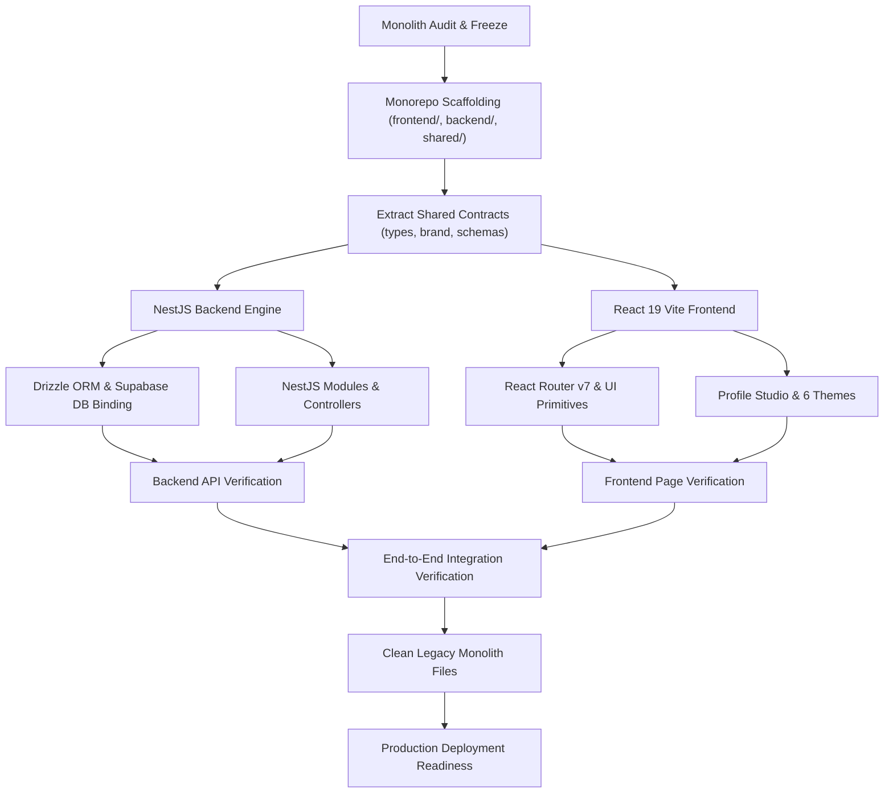

# TAPTCH — Architecture Migration Plan
## Strategic Road Map: Monolith to Decoupled React (Vite) + NestJS

---

## 1. Migration Strategy: Phased Monorepo Transition

To ensure zero downtime, 100% preservation of all features, and safe parallel verification:

1. **Step 1: Monorepo Foundation**:
   - Establish root workspace structure:
     - `frontend/` (React 19 + Vite + TypeScript)
     - `backend/` (NestJS 11 + TypeScript)
     - `shared/` (Types, DTO schemas, brand config)
2. **Step 2: Shared Layer Extraction**:
   - Extract `src/config/brand.ts`, domain types, Zod schemas into `shared/`.
3. **Step 3: Backend Implementation (NestJS)**:
   - Scaffold NestJS 11 application with modular design.
   - Integrate Drizzle ORM preserving all 38 Supabase tables.
   - Implement Auth Guard, Session verification, Role Guards (`can()`).
   - Implement domain modules:
     - `HealthModule`, `AuthModule`, `ProfilesModule`, `QrModule`, `CardsModule`, `LeadsModule`, `OrdersModule`, `OrgsModule`, `TemplatesModule`, `AdminModule`, `MediaModule`.
   - Setup Swagger/OpenAPI documentation at `/api/docs`.
   - Implement Redis cache service & BullMQ queue handlers.
4. **Step 4: Frontend Migration (React 19 + Vite)**:
   - Scaffold React 19 + Vite 6 + Tailwind CSS application.
   - Configure React Router v7 with all 36 routes and layouts.
   - Port all Radix UI components, Obsidian Luxury theme tokens, and Lucide icons.
   - Port Profile Studio Workspace, dual-device live preview, and 6 luxury themes.
   - Integrate TanStack Query v5 with centralized Axios/Fetch API client communicating with NestJS backend.
5. **Step 5: Integration & Verification**:
   - Verify all authentication flows (login, register, forgot-password, session check).
   - Verify digital profile creation, section reordering, and public profile view (`/p/:slug`).
   - Verify dynamic QR generation, post-print batch export, and redirection (`/dq/:token`).
   - Run complete test suites (typecheck, lint, unit tests, integration tests).
6. **Step 6: Decommission Monolith**:
   - Safely remove legacy Next.js API routes and obsolete configuration files after full verification.
   - Update Dockerfile and deployment configurations for independent frontend and backend hosting.

---

## 2. Workstream Breakdown

---

## 3. Milestones & Gates

- **Gate 1**: Forensic Audit & Inventory Complete (`MIGRATION_AUDIT.md`, `FEATURE_INVENTORY.md`, etc.).
- **Gate 2**: Shared Package compiles cleanly with TypeScript strict mode.
- **Gate 3**: NestJS Backend boots with Drizzle ORM connected to Supabase and exposes all 42 endpoints.
- **Gate 4**: React Frontend builds with Vite and renders all 36 pages without console errors.
- **Gate 5**: Full Vitest test suites execute and pass against the new architecture.
- **Gate 6**: Monolith files cleanly retired and independent Dockerfiles validated.

