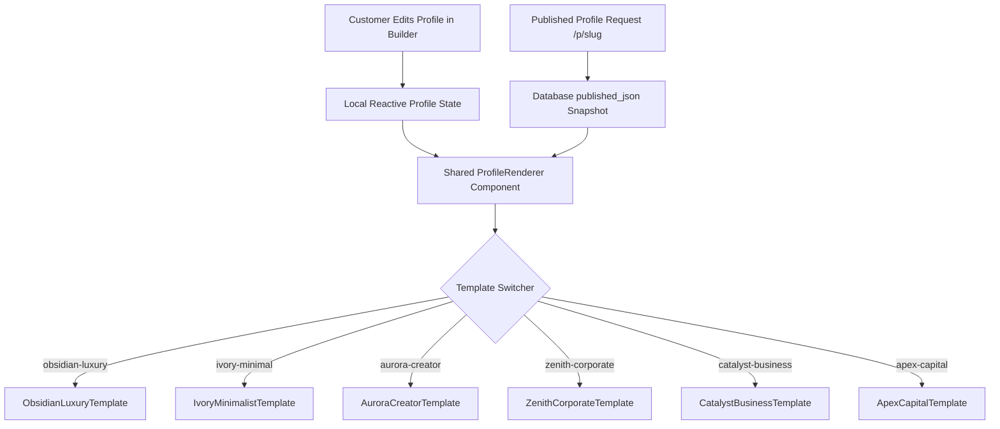

# TAPTCH — Architecture Report: Single Source of Truth & Domain Models

**Version:** 2.0.0  
**Standard:** Enterprise Clean Architecture (Presentation → Application → Domain → Infrastructure → Persistence)  

---

## 1. Unified Profile Rendering Pipeline

### Invariant Principles
1. **Identical Visual Output**: The template layout components render identically regardless of whether they are invoked within the builder preview or on the public SSR route `/p/[slug]`.
2. **Data-Theme Separation**: Changing `template_id` or `theme_config` alters only presentation tokens (`primaryColor`, `cardBg`, `fontFamily`). It never deletes, overwrites, or truncates profile fields (name, phone, businesses, catalogue items, socials).
3. **Zero Dynamic SSR Hot Path**: Public profiles `/p/[slug]` read the pre-compiled `published_json` snapshot, maintaining sub-100ms response times without relational database joins.

---

## 2. Six Distinct Luxury Template Systems

| Template | Aesthetic | Color Palette | Key Content Focus | Target Segment |
| :--- | :--- | :--- | :--- | :--- |
| **Obsidian Luxury** | Executive High-Contrast | `#0A0A0C` (Obsidian), `#121216` (Charcoal), `#D4AF37` (Metallic Gold) | VIP Verified Shield, executive bio, high-contrast actions, vCard | C-Suite executives, partners, enterprise founders |
| **Ivory Minimalist** | Warm Editorial Paper | `#FAF8F5` (Alabaster), `#FFFFFF` (Card), `#8C6D3B` (Warm Bronze) | Editorial serif typography, partner credentials, chambers address, discreet contact | Architects, doctors, writers, legal counsel |
| **Aurora Creator** | Neon Glassmorphism | `#0B0D1B` (Deep Navy), `#151833` (Glass), `#A855F7` (Neon Purple) | Visual portfolio grid, interactive project cards, dynamic social showcase | Designers, artists, content creators, digital agencies |
| **Zenith Corporate** | Precision Titanium Grid | `#0B0F19` (Navy), `#111827` (Card), `#2563EB` (Titanium Blue) | Corporate credentials, multiple venture switcher, B2B enquiry form | B2B executives, M&A advisors, corporate directors |
| **Catalyst Business** | High-Conversion Commerce | `#064E3B` (Emerald), `#065F46` (Card), `#059669` (Action Green) | Dedicated product/service shelves, dual-tab catalogue, instant WhatsApp enquiry | Retailers, product founders, showroom directors |
| **Apex Capital** | Private Wealth & Equity | `#022C22` (Dark Emerald), `#064E3B` (Graphite Card), `#10B981` (Mint Accent) | Prestige property/asset showcases, VIP escrow concierge, wealth advisory | Luxury real estate, private equity, venture capital |

---

## 3. Social Media & UPI Domain Models

### 3.1 Centralized Social Platforms
Supported platforms with automatic URL normalization:
- `instagram` → `https://instagram.com/{cleanUsername}`
- `facebook` → `https://facebook.com/{cleanUsername}`
- `linkedin` → `https://linkedin.com/in/{cleanUsername}`
- `twitter` / `x` → `https://x.com/{cleanUsername}`
- `youtube` → `https://youtube.com/@{cleanUsername}`
- `tiktok` → `https://tiktok.com/@{cleanUsername}`
- `whatsapp` → `https://wa.me/{cleanPhone}`
- `telegram` → `https://t.me/{cleanUsername}`
- `github` → `https://github.com/{cleanUsername}`
- `behance` → `https://behance.net/{cleanUsername}`
- `dribbble` → `https://dribbble.com/{cleanUsername}`
- `pinterest` → `https://pinterest.com/{cleanUsername}`
- `snapchat` → `https://snapchat.com/add/{cleanUsername}`

### 3.2 UPI Payment Intent Specification
- Standard URI format: `upi://pay?pa={vpa}&pn={payeeName}&cu=INR&tn={note}&am={amount}`
- Strict VPA Regex: `^[a-zA-Z0-9.\-_]{2,256}@[a-zA-Z]{2,64}$`
- Security Notice: Generating a UPI QR code creates an intent payload; it does not claim settlement verification.
