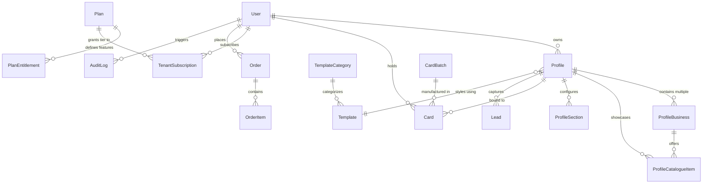

# Tapzio — Database Schema & Data Architecture
## Realigned Schema Supporting Digital Profiles, Multi-Business Associations & Dynamic Templates

**Product:** Tapzio  
**Platform Owner:** Webzio Technology  
**Database Engine:** PostgreSQL 17 (Supabase / Direct PgBouncer) + Embedded PGlite  
**ORM:** Drizzle ORM (`prepare: false`)  
**Document Version:** 2.0 (Product Vision Realignment)  
**Status:** Approved & Authoritative

---

## 1. Entity Relationship (ER) Diagram

---

## 2. Table Specifications & Definitions

### 2.1 Profiles & Digital Identity

#### `profiles`
The primary digital asset representing a Personal Identity or Single Business.
| Column | Type | Constraints | Description |
| :--- | :--- | :--- | :--- |
| `id` | VARCHAR(64) | PRIMARY KEY | Unique profile ID |
| `owner_id` | TEXT | NOT NULL, REFERENCES users(id) ON DELETE CASCADE | Profile owner |
| `organization_id`| TEXT | NULLABLE, REFERENCES organizations(id) | Associated organization |
| `profile_type` | VARCHAR(32) | NOT NULL, DEFAULT 'personal' | `personal` or `business` |
| `slug` | VARCHAR(128) | UNIQUE, NOT NULL | Public URL path (`/p/{slug}`) |
| `display_name` | VARCHAR(128) | NOT NULL | Person name or Company name |
| `headline` | VARCHAR(255) | NULLABLE | Professional title or Tagline |
| `bio` | TEXT | NULLABLE | Personal intro or Company overview |
| `avatar_url` | TEXT | NULLABLE | Profile photo or Company logo |
| `cover_url` | TEXT | NULLABLE | Hero header banner |
| `template_id` | VARCHAR(64) | NOT NULL, DEFAULT 'obsidian-luxury' | Selected visual template |
| `theme_config` | JSONB | NOT NULL, DEFAULT '{}' | Custom colors, fonts, buttons |
| `status` | VARCHAR(32) | NOT NULL, DEFAULT 'draft' | `draft`, `published`, `archived` |
| `version` | INTEGER | NOT NULL, DEFAULT 1 | Snapshot iteration |
| `published_json`| JSONB | NOT NULL, DEFAULT '{}' | High-speed static render snapshot |
| `published_at` | TIMESTAMPTZ | NULLABLE | Timestamp of last publication |
| `created_at` | TIMESTAMPTZ | NOT NULL, DEFAULT now() | Creation date |
| `updated_at` | TIMESTAMPTZ | NOT NULL, DEFAULT now() | Last update |

#### `profile_businesses`
Child businesses associated with a Personal Profile (e.g. John Mathew's multiple ventures).
| Column | Type | Constraints | Description |
| :--- | :--- | :--- | :--- |
| `id` | VARCHAR(64) | PRIMARY KEY | Unique business association ID |
| `profile_id` | VARCHAR(64) | NOT NULL, REFERENCES profiles(id) ON DELETE CASCADE | Parent personal profile |
| `name` | VARCHAR(255) | NOT NULL | Business entity name |
| `tagline` | VARCHAR(255) | NULLABLE | Business tagline |
| `logo_url` | TEXT | NULLABLE | Business logo |
| `cover_url` | TEXT | NULLABLE | Business cover banner |
| `description` | TEXT | NULLABLE | Business description / overview |
| `website` | VARCHAR(255) | NULLABLE | Business website |
| `email` | VARCHAR(255) | NULLABLE | Business email |
| `phone` | VARCHAR(32) | NULLABLE | Direct business phone |
| `whatsapp` | VARCHAR(32) | NULLABLE | Business WhatsApp |
| `address` | TEXT | NULLABLE | Physical office address |
| `google_maps_url` | TEXT | NULLABLE | Google Maps navigation link |
| `google_review_url` | TEXT | NULLABLE | Direct Google review submission link |
| `brochure_url` | TEXT | NULLABLE | PDF company brochure download |
| `social_links` | JSONB | NOT NULL, DEFAULT '[]' | Array of `{ platform, url }` |
| `display_order` | INTEGER | NOT NULL, DEFAULT 0 | Ordering index in business switcher |
| `created_at` | TIMESTAMPTZ | NOT NULL, DEFAULT now() | Creation date |
| `updated_at` | TIMESTAMPTZ | NOT NULL, DEFAULT now() | Last update |

#### `profile_catalogue_items`
Products and services offered by a Single Business Profile or an associated child business.
| Column | Type | Constraints | Description |
| :--- | :--- | :--- | :--- |
| `id` | VARCHAR(64) | PRIMARY KEY | Item ID |
| `profile_id` | VARCHAR(64) | NOT NULL, REFERENCES profiles(id) ON DELETE CASCADE | Parent profile |
| `business_id` | VARCHAR(64) | NULLABLE, REFERENCES profile_businesses(id) ON DELETE CASCADE | Associated business (if applicable) |
| `type` | VARCHAR(32) | NOT NULL | `product` or `service` |
| `title` | VARCHAR(255) | NOT NULL | Product or service title |
| `description` | TEXT | NULLABLE | Item description |
| `price` | VARCHAR(64) | NULLABLE | Price string (e.g. "₹4,999") |
| `currency` | VARCHAR(8) | NOT NULL, DEFAULT 'INR' | Currency code |
| `image_url` | TEXT | NULLABLE | Primary item photo |
| `action_url` | TEXT | NULLABLE | Link to buy, enquire, or book |
| `action_label` | VARCHAR(64) | NOT NULL, DEFAULT 'Enquire' | CTA label |
| `display_order` | INTEGER | NOT NULL, DEFAULT 0 | Sorting order |
| `created_at` | TIMESTAMPTZ | NOT NULL, DEFAULT now() | Creation date |

#### `profile_sections`
Defines section visibility, customizable labels, and reordering sequence.
| Column | Type | Constraints | Description |
| :--- | :--- | :--- | :--- |
| `id` | VARCHAR(64) | PRIMARY KEY | Section ID |
| `profile_id` | VARCHAR(64) | NOT NULL, REFERENCES profiles(id) ON DELETE CASCADE | Parent profile |
| `section_type` | VARCHAR(64) | NOT NULL | `identity`, `contacts`, `socials`, `bio`, `businesses`, `products`, `services`, `gallery`, `videos`, `brochure`, `google_review`, `google_maps`, `save_contact`, `exchange_contact` |
| `title` | VARCHAR(128) | NULLABLE | Custom section heading |
| `is_enabled` | BOOLEAN | NOT NULL, DEFAULT true | Section visibility toggle |
| `display_order` | INTEGER | NOT NULL, DEFAULT 0 | Sort sequence |
| `config_json` | JSONB | NOT NULL, DEFAULT '{}' | Custom section config & layout options |

---

### 2.2 Template Registry & Marketplace

#### `templates`
Metadata for visual profile templates.
| Column | Type | Constraints | Description |
| :--- | :--- | :--- | :--- |
| `id` | VARCHAR(64) | PRIMARY KEY | Template identifier (e.g. `obsidian-luxury`) |
| `name` | VARCHAR(128) | NOT NULL | Template display name |
| `slug` | VARCHAR(128) | UNIQUE, NOT NULL | URL identifier |
| `description` | TEXT | NOT NULL | Summary and aesthetic style |
| `category` | VARCHAR(64) | NOT NULL | `personal`, `business`, `corporate`, `creative`, `tech`, `real-estate`, etc. |
| `thumbnail_url`| TEXT | NOT NULL | Preview image |
| `supported_profile_types` | JSONB | NOT NULL, DEFAULT '["personal","business"]' | Compatible profile modes |
| `required_plan_id` | VARCHAR(32) | NOT NULL, DEFAULT 'nano' | Minimum plan required |
| `default_theme_config` | JSONB | NOT NULL, DEFAULT '{}' | Default colors, font family |
| `is_featured` | BOOLEAN | NOT NULL, DEFAULT false | Gallery showcase flag |
| `is_active` | BOOLEAN | NOT NULL, DEFAULT true | Availability status |
| `display_order` | INTEGER | NOT NULL, DEFAULT 0 | Sort order in gallery |

---

### 2.3 Subscription Plans & Feature Entitlements

#### `plans`
| Column | Type | Constraints | Description |
| :--- | :--- | :--- | :--- |
| `id` | VARCHAR(32) | PRIMARY KEY | `nano`, `micro`, `mini`, `max` |
| `name` | VARCHAR(64) | NOT NULL | Plan display name |
| `description` | TEXT | NULLABLE | Plan summary |
| `price_monthly` | NUMERIC(10,2)| NOT NULL, DEFAULT 0.00 | Monthly price (INR) |
| `price_yearly` | NUMERIC(10,2)| NOT NULL, DEFAULT 0.00 | Yearly price (INR) |
| `is_active` | BOOLEAN | NOT NULL, DEFAULT true | Plan availability |

#### `plan_entitlements`
Defines discrete feature flags and quotas for each plan tier.
| Column | Type | Constraints | Description |
| :--- | :--- | :--- | :--- |
| `id` | VARCHAR(64) | PRIMARY KEY | Entitlement record ID |
| `plan_id` | VARCHAR(32) | NOT NULL, REFERENCES plans(id) | Associated plan |
| `limit_key` | VARCHAR(64) | NOT NULL | e.g. `max_profiles`, `max_businesses`, `has_gallery`, `max_products`, `has_brochure_download` |
| `limit_value` | VARCHAR(64) | NOT NULL | Value (e.g. `'1'`, `'5'`, `'true'`, `'false'`) |

---

### 2.4 Physical NFC Smart Cards & Hardware Orders

#### `cards`
Physical NFC / QR hardware linked to a published profile.
| Column | Type | Constraints | Description |
| :--- | :--- | :--- | :--- |
| `id` | VARCHAR(64) | PRIMARY KEY | Unique card identifier |
| `token` | VARCHAR(32) | UNIQUE, NOT NULL | Unguessable edge token (`/n/{token}`) |
| `owner_id` | TEXT | NULLABLE, REFERENCES users(id) | Cardholder user |
| `profile_id` | VARCHAR(64) | NULLABLE, REFERENCES profiles(id) | Target profile |
| `status` | VARCHAR(32) | NOT NULL, DEFAULT 'unclaimed' | `unclaimed`, `active`, `deactivated` |
| `material` | VARCHAR(32) | NOT NULL, DEFAULT 'pvc' | `pvc`, `metal` |
| `activation_hash`| VARCHAR(255) | NULLABLE | Argon2id hash of 6-digit sleeve code |

#### `orders`
Physical hardware order requests.
| Column | Type | Constraints | Description |
| :--- | :--- | :--- | :--- |
| `id` | VARCHAR(64) | PRIMARY KEY | Order ID |
| `user_id` | TEXT | NOT NULL, REFERENCES users(id) | Purchasing user |
| `profile_id` | VARCHAR(64) | NULLABLE, REFERENCES profiles(id) | Profile to pre-link |
| `material` | VARCHAR(32) | NOT NULL, DEFAULT 'pvc' | `pvc` or `metal` |
| `quantity` | INTEGER | NOT NULL, DEFAULT 1 | Card quantity |
| `shipping_address`| JSONB | NOT NULL | Delivery details & phone |
| `order_status` | VARCHAR(32) | NOT NULL, DEFAULT 'requested' | `requested`, `in_production`, `qc`, `shipped`, `delivered` |
| `payment_status`| VARCHAR(32) | NOT NULL, DEFAULT 'unpaid' | `unpaid`, `paid_offline`, `waived` |
