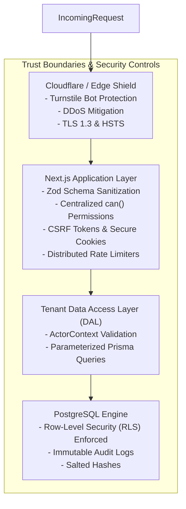

# Tapzio — Security Requirements & Compliance Specification

## 1. Security Architecture & Threat Model
Tapzio operates as a multi-tenant platform handling both public networking and private corporate identities. Security is enforced through defense-in-depth across the network, application, and database tiers.



---

## 2. PostgreSQL Row-Level Security (RLS) Policies

To prevent cross-tenant data leaks and IDOR vulnerabilities, RLS is enabled on sensitive tables in addition to application-level checks.

### 2.1 Context Injection via Session Variables
Every database connection or transaction sets the current tenant session variable before query execution:
```sql
SET LOCAL app.current_user_id = '8c22754c-7c09-43c2-8419-61f22ba54271';
SET LOCAL app.current_org_id = '12f8e132-0943-41bb-a5a4-9276d40fb11a';
SET LOCAL app.current_role = 'employee';
```

### 2.2 RLS Policy Definitions

#### Table: `profiles`
```sql
ALTER TABLE profiles ENABLE ROW LEVEL SECURITY;

-- 1. Public visitors can view published profiles
CREATE POLICY p_public_read ON profiles
    FOR SELECT
    USING (status = 'PUBLISHED' AND visibility = 'PUBLIC');

-- 2. Owners have full read/write access to their personal profiles
CREATE POLICY p_owner_access ON profiles
    FOR ALL
    USING (owner_id = current_setting('app.current_user_id', true)::uuid);

-- 3. Org admins have access to profiles within their organization
CREATE POLICY p_org_admin_access ON profiles
    FOR ALL
    USING (
        organization_id = current_setting('app.current_org_id', true)::uuid
        AND current_setting('app.current_role', true) IN ('org_owner', 'org_admin')
    );
```

#### Table: `leads`
```sql
ALTER TABLE leads ENABLE ROW LEVEL SECURITY;

-- 1. Public visitors can insert contact exchange leads
CREATE POLICY l_public_insert ON leads
    FOR INSERT
    WITH CHECK (true);

-- 2. Profile owners view leads captured on their profiles
CREATE POLICY l_owner_read ON leads
    FOR SELECT
    USING (
        profile_id IN (
            SELECT id FROM profiles WHERE owner_id = current_setting('app.current_user_id', true)::uuid
        )
    );

-- 3. Corporate managers view leads across their organization or department
CREATE POLICY l_org_read ON leads
    FOR SELECT
    USING (
        organization_id = current_setting('app.current_org_id', true)::uuid
        AND current_setting('app.current_role', true) IN ('org_owner', 'org_admin', 'dept_manager')
    );
```

#### Table: `cards`
```sql
ALTER TABLE cards ENABLE ROW LEVEL SECURITY;

-- 1. Inbound redirect reads active card by token (public edge)
CREATE POLICY c_public_redirect ON cards
    FOR SELECT
    USING (true);

-- 2. Card management restricted to verified owner or org admin
CREATE POLICY c_manage_access ON cards
    FOR UPDATE
    USING (
        assigned_user_id = current_setting('app.current_user_id', true)::uuid
        OR (
            organization_id = current_setting('app.current_org_id', true)::uuid
            AND current_setting('app.current_role', true) IN ('org_owner', 'org_admin')
        )
    );
```

---

## 3. Cryptographic Standards & Secret Management

### 3.1 Password & Sensitive Hash Storage
- **Argon2id**: Utilized for user password hashes and physical card activation codes (`activation_code_hash`).
  - Memory cost: 64MB ($65536$ KiB).
  - Time cost: 3 iterations.
  - Parallelism: 4 threads.

### 3.2 Unlinkable Card Redirect Tokens
- Hardware tokens encoded on NFC chips must never be sequential or guessable (e.g. `card-001`, `card-002` are prohibited).
- Generated using cryptographically secure PRNG (nanoid / base62, 10+ characters, $> 64$ bits of entropy).
- Prevents enumeration attacks across cards in production.

### 3.3 Analytics Privacy Hash
- Raw IP addresses are discarded instantly.
- Daily Salted Visitor Hash:
  $$\text{visitor\_hash} = \text{HMAC-SHA256}(\text{IP} + \text{UserAgent}, \text{DailySystemSalt})$$
- Salts rotate every 24 hours at 00:00 UTC and previous salts are purged, preventing long-term visitor tracking.

---

## 4. Anti-Abuse, Rate Limiting & Input Validation

### 4.1 Distributed Rate Limit Windows (Redis Token Bucket)
| Route / Action | Identifier | Ceiling | Window | Exceeded Action |
| :--- | :--- | :--- | :--- | :--- |
| Email / Phone OTP Request | IP + Phone/Email | 5 requests | 10 minutes | HTTP 429 + 15 min lock |
| Card Activation Attempt | IP + Token | 5 failures | 15 minutes | Lock token + notify admin |
| Contact Exchange Lead | IP + Profile Slug | 3 submissions | 10 minutes | Turnstile Challenge |
| Public Profile View | IP | 120 requests | 1 minute | Temporary throttle |
| Public NFC Redirect | Token | 300 requests | 1 minute | Burst allowance for events |

### 4.2 SSRF (Server-Side Request Forgery) Prevention
- Webhook dispatchers and link preview parsers reject private and reserved IPv4/IPv6 ranges:
  - `10.0.0.0/8`, `172.16.0.0/12`, `192.168.0.0/16`, `127.0.0.0/8`, `169.254.169.254` (cloud metadata).
- Enforce DNS resolution check before connecting (DNS rebinding defense).

### 4.3 Content Sanitization
- Custom HTML blocks are strictly parsed through DOMPurify with a rigid whitelist: `['b', 'i', 'p', 'span', 'strong', 'em', 'ul', 'ol', 'li', 'a']`.
- Javascript execution (`<script>`, `onerror=`, `onclick=`) is strictly stripped.

---

## 5. Compliance Framework (DPDP Act 2023 & GDPR)
1. **Notice & Explicit Consent**: Contact exchange requires an unticked checkbox with clear purpose specification.
2. **Right to Access & Portability**: Automated self-service one-click ZIP export containing all leads, profile versions, and uploaded media.
3. **Right to Erasure (Forgotten)**: Account termination purges all personal data, invalidates active card tokens, and cascades deletes to S3 object storage within 30 days.
4. **Data Minimization**: Public profiles serve strictly the fields marked visible in `publishedContent`. Internal metadata (notes, private numbers) is never transmitted over the wire.

