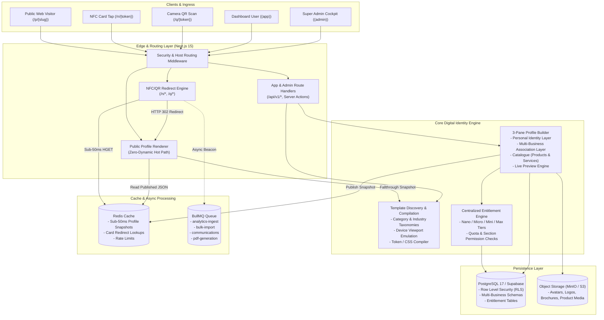

# Taptch — System Architecture Document
## Next-Gen Digital Identity & Template-Driven Platform Architecture

**Product:** Taptch  
**Platform Owner:** Webzio Technology  
**Architecture Style:** Modular Monolith with Decoupled Template Engine & Edge Redirects  
**Document Version:** 2.0 (Product Vision Realignment)  
**Status:** Approved & Authoritative

---

## 1. High-Level Architecture Overview

Taptch is architected around a central **Digital Profile & Template Engine**, with physical NFC smart cards acting as hardware edge gateways.



---

## 2. Core Architectural Pillars

### 2.1 Decoupled Template Engine
The template system strictly decouples **presentation** from **user profile data**:
1. **Normalized Data Model**: Profile identity, contacts, multiple businesses, product catalogues, and galleries exist in database tables independent of visual styling.
2. **Template Registry**: Each template defines visual layout components, typography sets, color token mappings, and supported profile modes (`personal` vs `business`).
3. **Seamless Hot-Swapping**: A user can change from an Obsidian Luxury template to an Ivory Minimalist or Tech-Modern template with a single click. Their existing information, multiple businesses, and catalogue items adapt instantly without re-entry.

### 2.2 Multi-Business Association Architecture
Personal profiles support multiple child businesses under a single authenticated account:
- **Identity Hierarchy**: `User` → `Profile (Personal)` → `[ProfileBusiness 1, ProfileBusiness 2, ...]`.
- **Catalogue Isolation**: Product and service catalogue entries can link to the overall profile or directly to a specific associated business.
- **Unified Management**: The user manages all ventures, logos, addresses, and catalogues from their central `/dashboard`.

### 2.3 Centralized Entitlement Engine
- Enforces subscription tier boundaries (**Nano**, **Micro**, **Mini**, **Max**) directly on the server before mutating database records.
- Blocks unauthorized features (e.g. adding a second business on Nano, adding image galleries on Nano, adding service catalogues on Mini).
- Client UI references the same entitlement matrix to gracefully display upgrade prompts rather than abruptly crashing.

### 2.4 High-Performance Edge Redirect & Public Hot Path
- **Permanent Constraint #13**: Public profile pages (`/p/[slug]`) never import dynamic cookies or headers that force server re-render.
- **Hardware Bridge**: Physical NFC smart cards store unguessable redirect URLs (`/n/{token}`). When tapped, the edge router resolves the card's active profile from Redis in `< 50ms` and redirects to `/p/{slug}`.

---

## 3. Directory & Module Boundaries

```
src/
├── app/
│   ├── (marketing)/         # Public landing, template showcase, pricing
│   ├── (profile)/           # Public digital profiles & hardware redirects
│   │   ├── p/[slug]/        # Public profile page (Static/ISR)
│   │   ├── n/[token]/       # NFC tap redirect handler (<50ms)
│   │   └── q/[token]/       # QR camera scan redirect handler
│   ├── (app)/               # Authenticated user cockpit
│   │   ├── dashboard/       # Main user dashboard
│   │   ├── templates/       # Template discovery & gallery marketplace
│   │   ├── builder/[id]/    # 3-pane self-service profile builder
│   │   ├── businesses/      # Multi-business manager
│   │   ├── cards/           # Physical NFC cards & activation
│   │   ├── leads/           # Captured contact leads CRM
│   │   └── settings/        # Account & plan settings
│   ├── (admin)/             # Administrative control cockpit
│   │   ├── admin/           # Platform overview, users, plans
│   │   ├── templates/       # Template management & categorization
│   │   └── orders/          # NFC hardware orders & production Kanban
│   └── api/
│       ├── auth/[...all]/   # Better Auth endpoint
│       └── v1/              # Versioned REST APIs (Zod validated)
├── modules/                 # Cohesive domain services
│   ├── profiles/            # Profile creation, update, draft/publish lifecycle
│   ├── templates/           # Template catalog, schema compiler, preview data
│   ├── businesses/          # Multi-business association management
│   ├── entitlements/        # Plan rules, feature flags, quota assertions
│   ├── cards/               # Card activation, token routing, hardware linking
│   ├── leads/               # Contact exchange, vCard generator, CRM
│   └── authz/               # RBAC permissions (can()) & tenant isolation
├── components/
│   ├── ui/                  # Obsidian Luxury primitive design system
│   ├── builder/             # 3-pane profile editor components
│   ├── templates/           # Template layout components & renderers
│   └── shared/              # Navigation, user menu, preview frames
└── db/                      # Drizzle ORM schema, migrations & seed scripts
```
