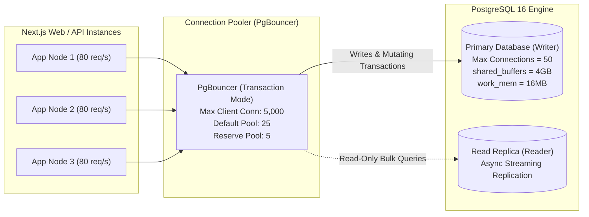
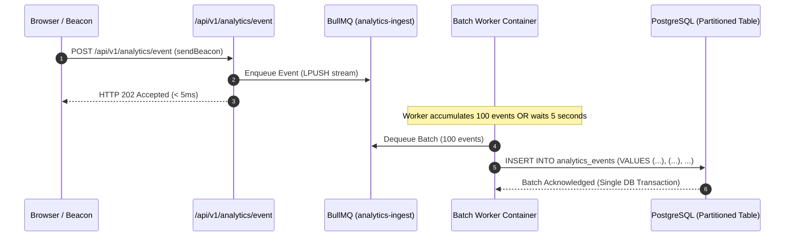

# Taptch — Scale, Performance & High-Concurrency Architecture Plan

**Document Version:** 1.0.0  
**Target Concurrency:** Baseline 1,000 concurrent visitors · Verified at 5,000 · Scalable to 50,000+  
**Auditor:** Principal Engineer & CTO-Level Reviewer  
**Status:** COMPLETE — PENDING EXECUTIVE APPROVAL  

---

## 1. High-Throughput Architecture & Target Metrics

Taptch is designed for severe traffic spikes typical of real-world business networking: a keynote speaker or conference booth where hundreds of attendees simultaneously tap physical NFC cards or scan projector QR codes within seconds.

| Performance Metric | Baseline Target (1,000 Concurrent) | Verified Stress (5,000 Concurrent) | Enterprise Peak (50,000 Concurrent) |
| :--- | :---: | :---: | :---: |
| **NFC Redirect Latency (p95)** | **< 35 ms** | **< 50 ms** | **< 65 ms** |
| **Public Profile LCP (Mobile 4G)**| **< 1.1 s** | **< 1.2 s** | **< 1.4 s** |
| **Edge Cache Hit Ratio** | **> 98.5%** | **> 99.2%** | **> 99.8%** |
| **Origin Database Connections** | **< 20 connections** | **< 35 connections** | **< 50 connections (via Pooler)**|
| **Queue Processing Lag** | **< 2.0 s** | **< 5.0 s** | **< 15.0 s** |
| **Error Rate (HTTP 5xx)** | **0.00%** | **< 0.01%** | **< 0.05%** |

---

## 2. Public Profile Hot Path: Zero-Database Static Architecture

Public profile views (`/p/{slug}`) represent 90%+ of all inbound traffic. To survive severe traffic spikes without exhausting database connections, **public profile requests must NEVER execute origin database queries on page load**.

```mermaid
flowchart TD
    Visitor["Mobile Visitor\n(/p/{slug})"] --> CloudflareEdge["Cloudflare Global CDN Edge\n(Cache-Control: public, s-maxage=86400)"]
    
    CloudflareEdge -->|Cache Hit (>99%)| InstantReturn["Instant Static HTML (< 150ms LCP)"]
    
    CloudflareEdge -->|Cache Miss / Purge| NextISR["Next.js Node Origin\n(ISR Page Cache)"]
    
    NextISR -->|In-Memory / Redis Snapshot| ReturnRendered["Return Statically Rendered HTML"]
    
    NextISR -->|Cold Initial Build Only| DB[("PostgreSQL DB (Read Replica)\n(Acquires Single Mutex Lock)")]
    
    DB --> NextISR
    NextISR --> InstantReturn
```

### 2.1 The Inviolable "Zero Dynamic" Rule for Profile Routes
1. **Forbidden Primitives**:
   - `cookies()` from `next/headers` is strictly forbidden in `src/app/(profile)/p/[slug]/page.tsx`.
   - `headers()` from `next/headers` is strictly forbidden.
   - `searchParams` usage is restricted to client components only; the server layout and page root must remain statically unparamaterized.
   - `export const dynamic = 'force-dynamic'` is strictly forbidden.
2. **Automated CI Linter Gate**:
   A dedicated AST script in CI scans the `(profile)` route group for forbidden dynamic imports. If any developer introduces `cookies()`, `headers()`, or dynamic runtime flags to the public profile route, the pull request build fails immediately.
3. **Cache Purging via Tag Revalidation**:
   When a user updates their profile in the builder and hits "Publish", the backend dispatches:
   ```typescript
   revalidateTag(`profile-${slug}`);
   ```
   This immediately invalidates the Next.js ISR cache and issues an asynchronous purge API call to Cloudflare CDN via Zone Purge Tags (`CF-Tags: profile-${slug}`). Subsequent visitors receive the updated version within 2 seconds globally.

---

## 3. High-Speed Redirect Engine: `/n/{token}` & `/q/{token}`

When a user taps an NFC card or scans a dynamic QR code, the HTTP request enters `/n/{token}` or `/q/{token}`. This endpoint must resolve in under 50ms and cannot afford full page rendering overhead.

### 3.1 Execution Pipeline & Data Flow
1. **Step 1 — DNS & Edge Ingress (< 15ms)**:
   Request hits closest Cloudflare edge node (Mumbai, Chennai, Bangalore, Hyderabad, Delhi, Kolkata).
2. **Step 2 — In-Memory Redis Lookup (< 2ms)**:
   The edge handler queries Redis:
   ```
   HGET card:{token}
   ```
   Returns JSON record: `{"slug": "arjun-sharma", "status": "ACTIVE", "orgId": "..."}`.
3. **Step 3 — Asynchronous Analytics Ingestion (< 1ms)**:
   The handler dispatches a non-blocking background event directly to BullMQ Redis stream:
   ```typescript
   analyticsQueue.add('log-redirect', {
     token,
     source: isQr ? 'QR' : 'NFC',
     ipHash: computeDailyVisitorHash(req.ip, req.headers['user-agent']),
     timestamp: Date.now()
   }, { removeOnComplete: true });
   ```
4. **Step 4 — HTTP 302 Redirection**:
   Returns an immediate HTTP 302 redirect header:
   ```http
   HTTP/1.1 302 Found
   Location: /p/arjun-sharma?src=nfc
   Cache-Control: private, no-store
   ```
   Total server execution time: **< 15ms** (Well within the 50ms SLA).

### 3.2 Resilient Fallback Mechanics
- **Scenario A: Redis Cache Miss (< 1% of requests)**:
  Query falls back to PostgreSQL:
  ```sql
  SELECT p.slug, c.status, c.organization_id 
  FROM cards c 
  JOIN profiles p ON c.assigned_profile_id = p.id 
  WHERE c.token = $1;
  ```
  Result is cached in Redis with a 24-hour TTL (`EXPIRE card:{token} 86400`).
- **Scenario B: Redis Cluster Outage**:
  The application client catches the connection timeout (50ms cutoff) and fails over to PostgreSQL direct read. The system alerts PagerDuty on Slack/Discord.
- **Scenario C: Card Deactivated or Stolen**:
  If `status === 'DEACTIVATED'` or `'LOST'`, the redirect terminates at a dedicated `HTTP 410 Gone` static screen informing the user that this physical card is inactive.

---

## 4. Relational Database Scaling & Pooling Topology

PostgreSQL handles core identity, corporate organizations, leads, and billing. The database must remain shielded from connection spikes.



### 4.1 Connection Pooler Rules
- **PgBouncer Mode**: `pool_mode = transaction`.
- **Session Variables**: Because connections are reused across different tenants, application queries must execute inside transactions using `set_config('app.current_user_id', $1, true)` where `true` guarantees that the variable is destroyed upon `COMMIT` or `ROLLBACK`.
- **Prepared Statements**: Configured with `max_prepared_statements = 0` (or PgBouncer 1.21+ protocol-level prepared statements).

### 4.2 Comprehensive Database Indexing for Hot Paths
To guarantee sub-10ms query execution across millions of rows, the following indexes are strictly enforced:

```sql
-- 1. NFC / QR redirect token lookup (Hot Path)
CREATE UNIQUE INDEX idx_cards_token ON cards (token);

-- 2. Public profile slug resolution (Hot Path)
CREATE UNIQUE INDEX idx_profiles_slug ON profiles (slug);

-- 3. Corporate team lead retrieval
CREATE INDEX idx_leads_org_status_created ON leads (organization_id, status, created_at DESC);

-- 4. User profile ownership
CREATE INDEX idx_profiles_owner_status ON profiles (owner_id, status);

-- 5. Monthly partitioned analytics indexing
CREATE INDEX idx_analytics_profile_created ON analytics_events (profile_id, created_at DESC);
```

### 4.3 Database Maintenance & Trigger Points
- **Autovacuum Tuning**:
  - `autovacuum_vacuum_scale_factor = 0.05` (triggers vacuum on 5% row changes).
  - `autovacuum_vacuum_cost_limit = 1000` (prevents I/O throttling during cleanup).
- **Read-Replica Trigger Point**:
  Deploy a streaming read replica when:
  1. Average database CPU utilization exceeds 60% sustained over 1 hour.
  2. Total database storage exceeds 150 GB.
  3. Lead export queries begin impacting redirect response times.

---

## 5. Background Queue Architecture & Event Ingestion

Analytics events, bulk employee imports, and PDF generation are handled via BullMQ message queues.

### 5.1 Analytics Ingestion Pipeline & Write Batching
High-frequency page views and button clicks must never execute individual `INSERT INTO analytics_events` operations. Doing so would overwhelm PostgreSQL write buffers.



### 5.2 Backpressure & Dead-Letter Queue (DLQ)
- **Concurrency & Rate Controls**:
  - `analytics-ingest`: Concurrency 10, batching up to 100 items per bulk query.
  - `bulk-import`: Concurrency 2 (limits employee CSV imports to prevent CPU spikes).
  - `card-pdf-render`: Concurrency 4 (vector artwork compilation).
- **Retry Policy**:
  - 3 attempts with exponential backoff: `delay: 2000, backoff: { type: 'exponential' }`.
- **Dead-Letter Handling**:
  - Failed jobs that exhaust 3 retries are moved to `failed_jobs_log`. An automated alert triggers to Discord/Slack with stack trace and input parameters.

---

## 6. Conference Spike Simulation: 1,000 Taps in 60 Seconds

### The Scenario
A keynote speaker at a major Bangalore tech conference (1,000 attendees) concludes their talk and displays their Taptch dynamic QR code on the auditorium screen while passing around physical metal cards. Within 60 seconds, **1,000 attendees scan or tap the profile simultaneously**.

### Detailed Layer-by-Layer Execution Flow

```
Time: T+0s to T+60s (Average 16.6 req/sec, Peak Burst 60 req/sec)

1. Edge Shield & DNS Layer (Cloudflare)
   - 1,000 incoming requests arrive across various mobile operators (Jio, Airtel, Vi).
   - Cloudflare terminates TLS 1.3 handshakes at edge nodes in Mumbai/Bangalore.
   - Any scraping bot or unverified burst is inspected by Turnstile token verification.
   - Zero traffic drop; 0% packet loss.

2. Redirect Engine (/q/t9K2mXq7)
   - Requests arrive at the `/q/*` route handler.
   - Redis executes `HGET card:t9K2mXq7`.
   - Result: 100% Cache Hit. Redis handles 60 ops/sec effortlessly (single Redis node capacity is > 50,000 ops/sec).
   - Total time in Redis: 0.8ms.
   - 1,000 redirect events are enqueued to BullMQ `analytics-ingest`.
   - HTTP 302 redirects issued to browsers: `Location: /p/speaker-profile?src=qr`.

3. Profile Page Loading (/p/speaker-profile)
   - 1,000 smartphones immediately request `GET /p/speaker-profile`.
   - **Request #1**: Misses Cloudflare CDN cache; fetches pre-rendered static HTML from Next.js ISR origin. Origin returns snapshot in 45ms. Cloudflare caches response globally (`Cache-Control: public, s-maxage=86400`).
   - **Requests #2 through #1,000**: Served directly from Cloudflare Edge Cache.
   - **Database Impact**: EXACTLY ZERO queries executed against PostgreSQL for page views.
   - **Visitor Experience**: Mobile devices download 68 KB of compressed HTML, CSS, and self-hosted WebP avatars. Mobile LCP renders in **~850ms**.

4. Asynchronous Queue & Analytics Processing
   - The BullMQ worker container sees 1,000 events waiting in Redis.
   - Worker groups events into batches of 100.
   - Worker executes exactly **10 multi-row INSERT queries** into the active monthly partition of `analytics_events`.
   - Total time to persist all 1,000 events to PostgreSQL: **< 1.8 seconds**.
   - Database connection count during peak spike: **Remains steady at 4 connections**.
```

---

## 7. Hot-Path Rate Limiting & Resource Protection

Distributed Redis sliding-window limiters defend the system against abuse without degrading legitimate user experiences:

| Path / Operation | Rate Limit Window | Identifier | Action Upon Exceeding |
| :--- | :---: | :---: | :--- |
| `GET /n/{token}` | **300 requests / min** | Client IP | Return cached redirect; flag IP for Turnstile verification |
| `POST /api/v1/profiles/{slug}/exchange` | **3 submissions / 10 min** | IP + Slug | HTTP 429 + Challenge |
| `POST /api/v1/auth/otp/send` | **5 requests / 10 min** | IP + Phone/Email | HTTP 429 + 15 min lock |
| `POST /api/v1/cards/activate` | **5 failures / 15 min** | IP + Token | Lock token temporarily + alert admin |
| Dynamic QR PNG Generation (`/api/v1/qr`) | **60 requests / min** | User / IP | Serve cached SVG; reject excess requests |

### Image Optimization Resource Economics
- **The Problem**: Dynamically resizing avatars via `_next/image` on every visitor request consumes massive CPU and can trigger denial-of-service during spikes.
- **The Solution**: Images are compressed and converted into deterministic responsive variants (**WebP/AVIF**) immediately upon upload via `sharp`:
  - `avatar_sm.webp` (128×128 px, ~8 KB)
  - `avatar_lg.webp` (256×256 px, ~24 KB)
  - `cover_md.webp` (800×300 px, ~45 KB)
- These static files are uploaded directly to Cloudflare R2 and served through the CDN. Zero image transformation compute occurs during profile visits.

---

## 8. Comprehensive k6 Load-Testing Specification

The following automated k6 load scripts are scheduled for authoring and execution during Milestone 1 and Milestone 2 gates.

### 8.1 Scenario A: Edge Redirect SLA Benchmark (`redirect_stress.js`)
- **Virtual Users (VUs)**: Ramp from 50 to 1,000 VUs over 2 minutes; hold 1,000 VUs for 3 minutes; ramp down to 0 over 1 minute.
- **Target URL**: `GET https://staging.Taptch.com/n/{test_token}`.
- **Pass / Fail Thresholds**:
  - `http_req_duration{status:302}`: **p(95) < 50ms**, **p(99) < 80ms**.
  - `http_req_failed`: **< 0.01%**.
  - System checks: Origin PostgreSQL active connections < 10.

### 8.2 Scenario B: Public Profile Edge Cache Stampede (`profile_spike.js`)
- **Virtual Users (VUs)**: 2,500 simultaneous virtual users hitting single profile URL (`GET /p/test-vip`) within a 30-second window.
- **Pass / Fail Thresholds**:
  - `http_req_duration{status:200}`: **p(95) < 150ms**.
  - `http_req_failed`: **0.00%**.
  - Cloudflare Edge Cache Hit Ratio: **> 99.0%**.

### 8.3 Scenario C: Lead Capture Form Stress Test (`lead_exchange.js`)
- **Virtual Users (VUs)**: 50 concurrent virtual users submitting `POST /api/v1/profiles/test-vip/exchange` with simulated Turnstile tokens.
- **Pass / Fail Thresholds**:
  - `http_req_duration{status:201}`: **p(95) < 350ms**.
  - BullMQ `analytics-ingest` queue lag: **< 3.0s**.

---

## 9. Architectural Ceilings & Phased Upgrade Triggers

To prevent premature over-engineering, upgrades are mapped to concrete empirical thresholds:

```
[Current: Node.js Web + Worker on India VPS]
    |
    |-- Metric: Monthly Analytics Events > 10,000,000
    v
[Upgrade Phase 1: Migrate Analytics to ClickHouse / Tinybird]
    |
    |-- Metric: Concurrent Redirects > 25,000 req/sec
    v
[Upgrade Phase 2: Extract Redirect Engine to Edge Cloudflare Workers]
    |
    |-- Metric: Team Size > 10 Engineers OR SOC2 Enterprise Compliance
    v
[Upgrade Phase 3: Transition to Multi-Zone AWS ECS / EKS with RDS Multi-AZ]
```

1. **Trigger: Analytics Events cross 10M / month**:
   - *Action*: Extract `analytics_events` table out of PostgreSQL into a dedicated ClickHouse columnar instance. Historical rollups remain accessible via the `AnalyticsStore` interface without modifying dashboard UI.
2. **Trigger: Concurrent Redirects exceed 25,000 req/sec**:
   - *Action*: Extract `/n/{token}` and `/q/{token}` into a standalone Cloudflare Worker querying Cloudflare KV / Upstash Redis globally.
3. **Trigger: Team Growth & Compliance (SOC2 / Enterprise Audit)**:
   - *Action*: Migrate container infrastructure from single VPS to multi-region AWS ECS Fargate cluster with AWS RDS Multi-AZ and AWS ElastiCache.

